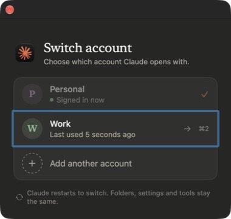

# Claude Accounts

Switch the **Claude desktop app** (macOS) between your accounts, such as personal and work, while keeping everything else on your Mac shared.

Only the sign-in changes. These stay exactly where they are:

- Your folders and projects
- Settings, MCP servers, extensions and `~/.claude`
- Your Claude Code sessions (Claude already keeps these in a separate folder for each account)



> **Unofficial.** This project is not made by or affiliated with Anthropic. It works by moving Claude's sign-in files around. That depends on how the current Claude desktop app stores them, so a Claude update could break it. Use it at your own risk.

## Install

You need macOS 14 or later, the Claude desktop app in `/Applications`, and the Xcode command line tools (`xcode-select --install`).

```bash
git clone https://github.com/18Abhinav07/claude-accounts.git
cd claude-accounts
./install.sh
```

This installs:

- `Claude Accounts.app` in `/Applications`
- The `claude-account` CLI in `~/Library/Application Support/Claude-Accounts/bin/`

## Use

1. Open **Claude Accounts** from Spotlight or your Applications folder.
2. The first time, give the account you're signed in to now a name, for example `personal`.
3. Click **Add another account** and give it a name, for example `work`. Claude restarts signed out. Sign in with the other account.
4. From then on, open Claude Accounts and click an account to switch. You can also press ⌘1 or ⌘2. Claude quits, the sign-in is swapped, and Claude reopens.

> ⚠️ **Don't use Claude's own "Log out" to switch.** Logging out can revoke the saved sign-in. Use **Add another account** instead.

### CLI

```bash
CA="$HOME/Library/Application Support/Claude-Accounts/bin/claude-account"
"$CA" list            # saved accounts (* = signed in now)
"$CA" switch work     # quit Claude, swap to 'work', reopen
"$CA" add client-x    # save current sign-in, reopen signed out
"$CA" rename work job
"$CA" status          # JSON, used by the app
```

## How it works

Claude stores your sign-in in a few files inside `~/Library/Application Support/Claude`:

- `Cookies`
- `Local Storage`, `Session Storage`, `IndexedDB` and `WebStorage`
- The `oauth:*` and `lastKnownAccountUuid` keys in `config.json`

When you switch, the app does this:

1. Quits Claude cleanly and waits for it to finish shutting down.
2. Backs up the current sign-in to `~/Library/Application Support/Claude-Accounts/backups/` (it keeps the last 10 backups).
3. Saves the current sign-in under its name in `accounts/`.
4. Restores the sign-in for the account you picked.
5. Reopens Claude.

Every other file is left alone. Saved sign-ins stay on your Mac. The tokens in them are still encrypted with Claude's own Keychain key, and their files are readable only by your user.

## Uninstall

```bash
rm -rf "/Applications/Claude Accounts.app"
rm -rf "$HOME/Library/Application Support/Claude-Accounts"   # also deletes saved sign-ins
```

## License

MIT
